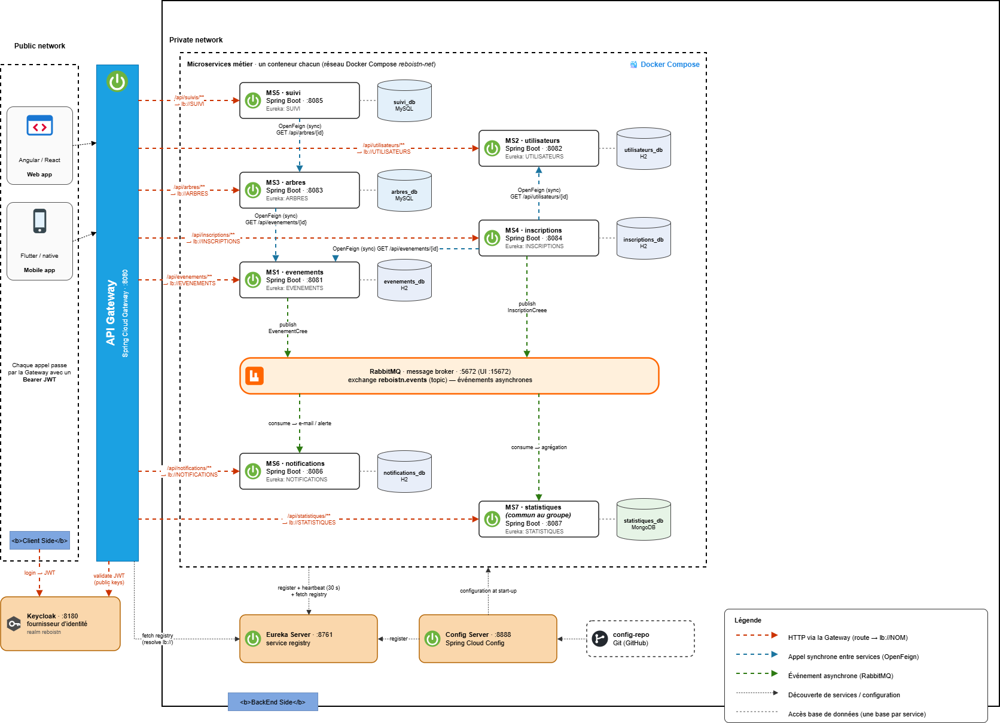

# ReboisTN – Reboisement et suivi des arbres en Tunisie

Projet MT-41 **Applications Web Distribuées** – ESPRIT 2026-2027
Équipe : **reboisTN-4SSA1-g3**

> Reboiser la Tunisie et suivre chaque arbre planté, de la plantation à la survie.

## Sommaire

1. [Présentation](#1-présentation)
2. [Architecture](#2-architecture)
3. [Microservices et équipe](#3-microservices-et-équipe)
4. [Technologies](#4-technologies)
5. [Lancement](#5-lancement)
6. [API](#6-api)
7. [Communication entre microservices](#7-communication-entre-microservices)
8. [Organisation du dépôt](#8-organisation-du-dépôt)
9. [Gestion de projet et Git](#9-gestion-de-projet-et-git)
10. [Documentation](#10-documentation)

---

## 1. Présentation

En Tunisie, 4 800 ha de forêt ont brûlé en 2023 (5 900 ha en 2022), avec 438 incendies pendant l'été 2023 (source : Webdo, décembre 2023).

**ReboisTN** répond à la question : *comment organiser les plantations, mobiliser les bénévoles et vérifier que les arbres plantés survivent ?*

La plateforme permet de :

- créer et gérer des journées de plantation (lieu, date, places) ;
- inscrire des bénévoles et enregistrer leur présence ;
- enregistrer chaque arbre planté (espèce, position GPS, date) ;
- suivre la survie des arbres avec des contrôles et des photos ;
- envoyer des rappels et des confirmations aux bénévoles ;
- calculer le taux de survie par zone et par espèce.

### Acteurs

| Acteur | Rôle |
|---|---|
| Visiteur | Consulte les événements et la carte des plantations |
| Bénévole | S'inscrit aux plantations, plante des arbres, reçoit des notifications |
| Organisateur | ONG, école ou municipalité : crée les événements, gère les inscriptions, suit la survie. Il dispose aussi des droits du bénévole |
| Admin | Gère les comptes, les organisations et les espèces, consulte les statistiques |

L'authentification et les rôles sont gérés par **Keycloak**.

## 2. Architecture



- Chaque appel client passe par l'**API Gateway** (port 8080) avec un jeton JWT Keycloak.
- La Gateway route vers les microservices avec `lb://NOM` grâce à **Eureka** (service registry).
- Le **Config Server** (mode `native`, dossier `Backend/config-repo`) fournit la configuration commune.
- Chaque microservice possède **sa propre base de données**.
- Appels **synchrones** entre services : OpenFeign (avec fallback Resilience4j).
- Événements **asynchrones** : RabbitMQ (exchange `reboistn.events`).

## 3. Microservices et équipe

| Microservice | Port | Responsable | Base | Responsabilité |
|---|---|---|---|---|
| `ms-evenements` | 8081 | Thouraya Allagui | H2 | Journées de plantation |
| `ms-utilisateurs` | 8082 | Kmar Srarfi | H2 | Profils et organisations |
| `ms-arbres` | 8083 | Mezen Elghoul | MySQL | Registre des arbres et espèces |
| `ms-inscriptions` | 8084 | Ghofrane Jridi | H2 | Inscriptions, places, présence |
| `ms-suivi` | 8085 | Souhail Mechergui | MySQL | Contrôles de survie, photos |
| `ms-notifications` | 8086 | Ayoub Abed | H2 | Alertes e-mail et in-app |
| `ms-statistiques` | 8087 | Groupe (microservice commun) | MongoDB | Taux de survie et bilans |

Infrastructure :

| Composant | Port | Rôle |
|---|---|---|
| `api-gateway` | 8080 | Point d'entrée unique |
| `discovery-server` (Eureka) | 8761 | Registre des services |
| `config-server` | 8888 | Configuration centralisée |
| Keycloak | 8180 | Authentification, rôles, JWT |
| RabbitMQ | 5672 (console 15672) | Broker de messages |

### État d'avancement

| Élément | État |
|---|---|
| `discovery-server`, `config-server`, `api-gateway`, Docker Compose d'infrastructure | Disponibles |
| `ms-utilisateurs`, `ms-evenements` | Disponibles |
| `ms-inscriptions`, `ms-arbres`, `ms-suivi`, `ms-notifications`, `ms-statistiques` | En cours, ajoutés au dépôt au fil des séances |
| Sécurité Keycloak (validation JWT à la Gateway) | Prévue en S8 |
| Front-end Angular | Prévu |

## 4. Technologies

| Domaine | Technologie |
|---|---|
| Microservices | Java 17, Spring Boot |
| API Gateway, découverte | Spring Cloud Gateway, Eureka |
| Configuration | Spring Cloud Config Server |
| Sécurité | Keycloak (rôles, JWT) |
| Conteneurisation | Docker, Docker Compose |
| Bases de données | H2, MySQL, MongoDB (une base par service) |
| Communication | OpenFeign (synchrone), RabbitMQ (asynchrone), Resilience4j (pannes) |
| Documentation API | Swagger / OpenAPI |
| Front-end | Angular, Leaflet (carte) |

## 5. Lancement

### Prérequis

- JDK 17
- Maven (ou le wrapper `mvnw` fourni dans `ms-evenements`)
- Docker et Docker Compose

### 5.1 Infrastructure avec Docker Compose

```bash
cd Backend
docker compose up -d --build
```

Services démarrés : Eureka, Config Server, API Gateway, RabbitMQ et Keycloak.

| Service | URL |
|---|---|
| Eureka | http://localhost:8761 |
| Config Server | http://localhost:8888 |
| API Gateway | http://localhost:8080 |
| RabbitMQ (console) | http://localhost:15672 (guest / guest) |
| Keycloak | http://localhost:8180 (admin / admin) |

Arrêter : `docker compose down`

### 5.2 Un microservice en local

```bash
cd Backend/microservices/ms-utilisateurs
mvn spring-boot:run
```

```bash
cd Backend/microservices/ms-evenements
./mvnw spring-boot:run        # Windows : mvnw.cmd spring-boot:run
```

| Microservice | URL directe |
|---|---|
| `ms-utilisateurs` | http://localhost:8082 |
| `ms-evenements` | http://localhost:8081 |

Vérifier qu'un service répond :

```bash
curl http://localhost:8082/api/utilisateurs/hello
```

Via la Gateway, avec Eureka démarré :

```bash
curl http://localhost:8080/api/utilisateurs/hello
```

Chaque microservice documente son lancement dans son propre `README.md` (Swagger UI, console H2).

## 6. API

Toutes les routes passent par la Gateway (`http://localhost:8080`).

| Préfixe | Microservice |
|---|---|
| `/api/utilisateurs/**` | `ms-utilisateurs` |
| `/api/evenements/**` | `ms-evenements` |
| `/api/inscriptions/**` | `ms-inscriptions` |
| `/api/arbres/**` | `ms-arbres` |
| `/api/suivis/**` | `ms-suivi` |
| `/api/notifications/**` | `ms-notifications` |
| `/api/statistiques/**` | `ms-statistiques` |

### ms-utilisateurs

| Méthode | URI | Codes HTTP |
|---|---|---|
| GET | `/api/utilisateurs/hello` | 200 |
| GET | `/api/utilisateurs` | 200 |
| GET | `/api/utilisateurs/{id}` | 200, 404 |
| GET | `/api/utilisateurs/me` | 200, 401, 404 |
| POST | `/api/utilisateurs` | 201, 400, 409 |
| PUT | `/api/utilisateurs/{id}` | 200, 400, 404, 409 |
| DELETE | `/api/utilisateurs/{id}` | 204, 404 |
| GET | `/api/utilisateurs/organisations` | 200 |
| GET | `/api/utilisateurs/organisations/{id}` | 200, 404 |
| POST | `/api/utilisateurs/organisations` | 201, 400 |

### ms-evenements

| Méthode | URI | Fonction |
|---|---|---|
| POST | `/api/evenements` | Créer un événement |
| GET | `/api/evenements` | Lister les événements |
| GET | `/api/evenements/{id}` | Consulter un événement |
| PUT | `/api/evenements/{id}` | Modifier un événement |
| DELETE | `/api/evenements/{id}` | Supprimer un événement |
| PATCH | `/api/evenements/{id}/publier` | Publier un événement |
| PATCH | `/api/evenements/{id}/annuler` | Annuler un événement |
| GET | `/api/evenements/{id}/disponibilite` | Vérifier les places disponibles |
| GET | `/api/evenements/{id}/inscription-possible` | Vérifier l'éligibilité à l'inscription |

### Autres microservices

Les contrats d'API de `ms-inscriptions`, `ms-arbres` et `ms-suivi` sont décrits dans le [dossier technique](Documentation/ReboisTN_Dossier_Technique.docx) et dans la [présentation](Documentation/Presentation/ReboisTN_Presentation.pdf).

### Codes HTTP utilisés

| Code | Signification |
|---|---|
| 200 | Succès |
| 201 | Ressource créée |
| 204 | Suppression réussie |
| 400 | Requête invalide |
| 401 / 403 | Non authentifié / accès refusé (Keycloak, S8) |
| 404 | Ressource introuvable |
| 409 | Conflit métier |
| 503 | Service indisponible (fallback) |

## 7. Communication entre microservices

### Synchrone (OpenFeign)

| Appelant | Appelé | Usage |
|---|---|---|
| `ms-inscriptions` | `ms-evenements` | Événement publié avec des places libres |
| `ms-inscriptions` | `ms-utilisateurs` | Le bénévole existe |
| `ms-arbres` | `ms-evenements` | L'événement existe |
| `ms-suivi` | `ms-arbres` | L'arbre existe |
| `ms-notifications` | `ms-utilisateurs` | Email du destinataire (repli : notification in-app seule) |

### Asynchrone (RabbitMQ, exchange `reboistn.events`)

| Événement | Producteur | Consommateurs |
|---|---|---|
| `EvenementCree` | `ms-evenements` | `ms-notifications`, `ms-statistiques` |
| `InscriptionCreee` | `ms-inscriptions` | `ms-notifications`, `ms-statistiques` |
| `ArbrePlante` | `ms-arbres` | `ms-notifications`, `ms-statistiques` |
| `ControleEnregistre` | `ms-suivi` | `ms-arbres`, `ms-notifications`, `ms-statistiques` |

## 8. Organisation du dépôt

```text
reboisTN/
├── Backend/
│   ├── api-gateway/
│   ├── discovery-server/
│   ├── config-server/
│   ├── config-repo/              # configuration servie par le Config Server
│   ├── microservices/
│   │   ├── ms-utilisateurs/
│   │   ├── ms-evenements/
│   │   ├── ms-inscriptions/
│   │   ├── ms-arbres/
│   │   ├── ms-suivi/
│   │   ├── ms-notifications/
│   │   └── ms-statistiques/
│   └── docker-compose.yml
├── Frontend/
│   ├── WebApp/
│   └── MobileApp/
├── Documentation/
│   ├── Diagrams/
│   │   ├── Architecture-Technique/
│   │   ├── Classes-Analyse/
│   │   └── Classes-Domaine/
│   ├── Presentation/
│   └── ReboisTN_Dossier_Technique.docx
└── README.md
```

## 9. Gestion de projet et Git

- **Outil de gestion** : [GitHub Projects](https://github.com/thourayaallagui/reboisTN/projects) (tableau Kanban).
  - Colonnes : Backlog → À faire → En cours → En revue → Terminé.
  - Une carte par tâche, avec un responsable, un label par microservice et un jalon (S5 à S9).
  - Réunion de 15 minutes chaque semaine pour mettre le tableau à jour.
- **Branches** : `main` est la branche stable. Chaque fonctionnalité est développée sur une branche dédiée, puis fusionnée par Pull Request.
- **Commits** : messages explicites, par exemple `docs(dossier): ...` ou `feat(ms-utilisateurs): ...`.

## 10. Documentation

- [Dossier technique](Documentation/ReboisTN_Dossier_Technique.docx)
- [Présentation](Documentation/Presentation/ReboisTN_Presentation.pdf)
- [Diagramme d'architecture](Documentation/Diagrams/Architecture-Technique/architecture-technique.png)
- [Diagramme de classes d'analyse](Documentation/Diagrams/Classes-Analyse/classes-analyse.png)
- [Diagramme de classes du domaine](Documentation/Diagrams/Classes-Domaine/classes-domaine.png)
- README de chaque microservice : [`ms-utilisateurs`](Backend/microservices/ms-utilisateurs/README.md), [`ms-evenements`](Backend/microservices/ms-evenements/README.md)
